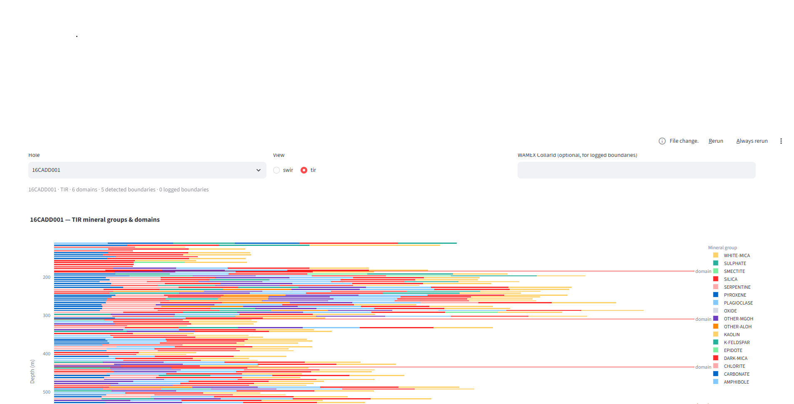

<!--
HyFuse pitch deck (T4.5). Build to PDF (<=25 MB) for the submission form:
    npx @marp-team/marp-cli reports/pitch.md -o pitch.pdf --allow-local-files
Every number is from reports/ (not hand-entered). Do NOT commit the PDF — it is
a submission-form attachment. The viewer image is ../docs/viewer.png (same one
the README uses); --allow-local-files lets Marp embed it.
-->
---
marp: true
theme: default
paginate: true
title: "HyFuse — SWIR+TIR fusion (GSWA Hackathon 2026)"
style: |
  section { font-size: 24px; }
  section h1 { font-size: 40px; }
  section h2 { font-size: 30px; }
  table { font-size: 22px; }
  code { font-size: 20px; }
---

# HyFuse
## View-aware fusion of SWIR + TIR HyLogger mineralogy

GSWA HyLogger Hackathon 2026 · **Data Crunch**

Team: **HyFuse Team** · github.com/sbenayoun/hyfuse

---

# The problem

**Combining SWIR and TIR HyLogger results is an unsolved problem (GSWA).**

- The two sensors see different minerals: a rock that is 97% quartz / 3% chlorite
  reads **quartz-dominant in TIR** but **chlorite-only in SWIR**.
- GSWA: a good way to combine them "would be a powerful tool".

> **Our question:** does fusing SWIR + TIR recover geological domains and
> gold-related properties better than either view alone — on drillholes the
> method has never seen?

---

# What we built

**A reproducible pipeline + viewer, and a four-arm ablation.**

`fetch → QC (Final Mask, units, below-detection) → 5 m windows → per-view`
`compositional features → domaining (PCA→HDBSCAN→ruptures) → score on HELD-OUT holes`

Four arms on identical windows: **SWIR only · TIR only · naive concat · fused**.
Scored by boundary agreement vs logged lithology (permutation baseline) and gold
prediction (leave-holes-out CV).

---

# How we tested it (the trust story)

- **Pre-registered** success criteria, tolerance, CV scheme — frozen in git
  *before* any results.
- **Leave-holes-out** CV + permutation baseline + **hole-level bootstrap**.
- **Planted-truth** simulation + **corruption tests** (×1000 units, depth offset,
  ignored mask, shuffled IDs) that must fail loudly.
- **4 independent reviews** + a **calibration** that planted 3 defects and
  confirmed the reviewer caught **3/3**.

> Built to give a *trustworthy* answer — positive or not.

---

# The result (stated plainly)

**15 gold holes → INCONCLUSIVE. Fusion is no better than the best single view.**

| arm | boundary F1 | gold Au R² (held-out) |
|---|---:|---:|
| SWIR only | 0.102 | no skill |
| TIR only | 0.139 | no skill |
| naive concat | 0.129 | no skill |
| **fused** | **0.140** | no skill |

- Fused − best single (TIR): **+0.001**, 95% CI **[−0.017, +0.022]** (includes zero).
- **No arm predicts gold** on held-out holes (all median R² ≤ 0).

---

# What we checked, and the limits

- Domains are **not** explained by processing level (confounder check).
- Planted-truth agreed: on known-answer data, TIR alone matched any fusion.
- **Limits:** n = 15, **11/15 one deposit** (Bannockburn) + 4 regional → weak
  generality; assays are selection-biased; not yet geologically validated.

> Anomalies here are "evidence worth investigating", never mineralisation.

---

# What GSWA gets, and next steps

- A **reproducible pipeline** (`make fetch → evaluate`, bit-for-bit) + config +
  an interactive viewer, public and MIT-licensed.
- A **method result:** for these holes, TIR alone is as good as fusion, and
  mineralogy alone does not predict gold across holes.
- **Next:** more holes across *different* deposits; expert-labelled domains; test
  fusion where SWIR and TIR genuinely disagree (chlorite bridge).

**Repo:** github.com/sbenayoun/hyfuse

---

# Appendix (backup)

- Why CLR failed → we use Hellinger (`reports/planted_truth.md`).
- Per-hole boundary table + permutation p-values (`reports/ablation.md`).
- The 97/3 quartz/chlorite case reproduced in simulation.
- Reviewer calibration found/missed table (`reports/calibration.md`).
